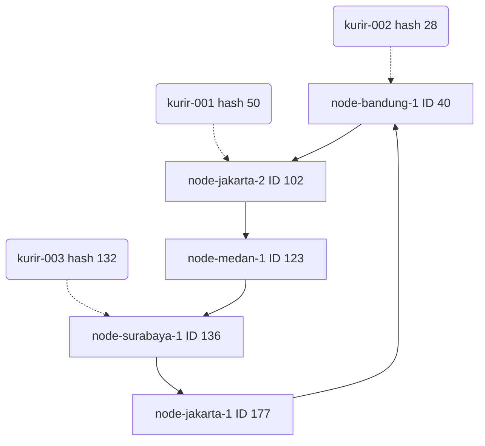

# Tugas 6 (Pekan 6) — Penamaan & Resolusi Lokasi

**Materi terkait:** Flat Naming, Structured Naming (DNS), Distributed Hash Table (DHT)/Chord.

## Studi Kasus

Pelanggan FoodGo kesulitan menemukan alamat IP server kurir yang **dinamis** (kurir berpindah lokasi/jaringan, IP-nya sering berubah). FoodGo butuh cara memetakan **ID Kurir** (identitas tetap) ke **alamat IP terkininya** tanpa server pusat tunggal yang jadi bottleneck/single point of failure.

## Tugas Kelompok

Implementasikan **simulasi Chord DHT** sederhana (single-process, tidak perlu jaringan sungguhan — cukup simulasi struktur data & algoritma di satu program Python) yang memetakan ID Kurir ke alamat IP mereka.

Konsep yang harus terlihat jalan dalam simulasi kalian:
1. **Consistent hashing**: ID Kurir dan ID Node di-hash ke ruang angka yang sama (mis. 0–255 untuk kesederhanaan, `m=8` bit).
2. **Ring topology**: node-node diurutkan melingkar berdasarkan hasil hash-nya.
3. **Lookup**: fungsi `lookup(kurir_id)` yang menemukan node mana yang bertanggung jawab menyimpan mapping ID Kurir tersebut → alamat IP-nya (aturan Chord: node dengan ID hash **terkecil yang lebih besar atau sama dengan** hash key, disebut *successor*).
4. **Perubahan topologi**: simulasikan minimal satu node baru bergabung (`join`) atau satu node keluar (`leave`), tunjukkan bagaimana mapping berpindah tanggung jawab ke node lain.

Skeleton disediakan di `src/chord_simulation.py` dengan fungsi hashing dan struktur ring sudah ada — bagian `lookup()`, `join()`, dan `leave()` sengaja dikosongkan.

### Cara Menjalankan

```bash
python3 src/chord_simulation.py
```

## Tugas Analisis (`README.md`)

1. Jelaskan **kenapa DHT/Chord** lebih cocok untuk kasus ini dibanding **flat naming sederhana** (mis. tabel pusat ID→IP) atau **DNS konvensional** — kaitkan dengan sifat "IP kurir sering berubah" dan kebutuhan tanpa titik gagal tunggal.
2. Gambarkan (boleh pakai Mermaid, lihat Tugas 2) ring topology dari simulasi kalian, tandai node mana yang bertanggung jawab atas ID Kurir mana.
3. Jelaskan apa yang terjadi pada mapping saat sebuah node **keluar** dari ring (siapa yang mengambil alih tanggung jawabnya) — dukung dengan output program.

## Jawab
1. Perbandingan DHT/Chord dengan Flat Naming dan DNS Konvensional
Penggunaan DHT/Chord jauh lebih cocok untuk pelacakan IP kurir dibandingkan flat naming berbasis tabel pusat maupun DNS konvensional. Tabel pusat memiliki kelemahan fatal berupa Single Point of Failure (SPOF); apabila server pusat mati, maka seluruh proses lookup IP kurir akan gagal total. Selain itu, server pusat rentan menjadi bottleneck saat volume permintaan tinggi.

Di sisi lain, DNS konvensional dirancang untuk pemetaan domain ke IP yang sifatnya relatif statis dan mengandalkan sistem caching berjenjang (TTL). Pada kasus kurir di mana alamat IP sering berubah-ubah secara dinamis saat berpindah jaringan, DNS akan menghadapi kendala stale cache jika TTL terlalu lama, atau kelebihan beban kueri jika TTL dibuat terlalu singkat.

Chord DHT menyelesaikan kedua masalah tersebut karena bekerja secara terdesentralisasi tanpa server pusat. Setiap node saling membagi beban pemetaan menggunakan consistent hashing. Ketika kurir memperbarui IP-nya, pembaruan langsung disimpan pada node penanggung jawab hash ID kurir tersebut, sehingga data IP terbaru dapat langsung ditemukan dengan cepat tanpa risiko kegagalan sistem terpusat.

2. Ring Topology Diagram
````markdown

````

3. Perpindahan Mapping saat Node Keluar 
Ketika sebuah node keluar dari ring secara normal, node tersebut harus memindahkan seluruh data dan tanggung jawab key yang dimilikinya ke successor langsungnya, yaitu node aktif berikutnya yang berada searah jarum jam pada ring identifier.

Hal ini terbukti dari log eksekusi terminal ketika node-jakarta-1 (id=177) keluar dari ring:
```markdown
--- Sebuah node keluar ---
[MIGRASI] Data dari node 'node-jakarta-1' (id=177) dialihkan ke successor id=40
[TODO] Node 'node-jakarta-1' (id=177) keluar dari ring
kurir-001 -> 192.168.1.10
kurir-002 -> 192.168.1.11
```

Karena urutan identifier bersifat melingkar (wrap-around setelah 255 kembali ke 0), node aktif pertama setelah id=177 adalah node-bandung-1 dengan id=40. Oleh sebab itu, seluruh tanggung jawab data dari node-jakarta-1 langsung dialihkan ke node id=40. Mekanisme migrasi ini memastikan lookup terhadap kurir-001 dan kurir-002 tetap berhasil mengembalikan IP yang benar tanpa terjadi kehilangan data (data loss).
## Struktur Submission

```
tugas-06-penamaan-dht/
├── README.md      # Analisis + diagram ring
├── JURNAL.md
├── src/
│   └── chord_simulation.py
└── bukti/          # Output program (screenshot/log) untuk skenario join & leave
```

## Rubrik Penilaian (Tugas 6)

| Komponen | Bobot | Kriteria |
|---|---|---|
| Implementasi lookup/join/leave benar | 35% | Consistent hashing & successor lookup sesuai aturan Chord |
| Bukti perubahan topologi (join/leave) | 25% | Output menunjukkan mapping berpindah dengan benar |
| Analisis kenapa DHT vs flat naming/DNS | 25% | Argumen spesifik ke kasus IP kurir dinamis, bukan definisi umum |
| Proses & kontribusi kelompok | 15% | `JURNAL.md`, commit history |

## Batasan Penggunaan AI (Level 2)

Kebijakan **Level 2 (AI Assisted Idea Generation & Structuring)** berlaku — lihat [`../RUBRIK-UMUM.md`](../RUBRIK-UMUM.md). Boleh bertanya konsep umum consistent hashing/Chord ke AI; **tidak boleh** meminta AI menuliskan isi `# TODO` di `src/chord_simulation.py` (`find_successor`, `join`, `leave`, dst). Catat pemakaian AI di "Log Penggunaan AI" pada `JURNAL.md`.

- `README.md` wajib menelusuri manual (langkah demi langkah) bagaimana `lookup()` menemukan successor untuk salah satu ID Kurir contoh yang dipakai di `chord_simulation.py` — bukan cuma menempelkan output program.
