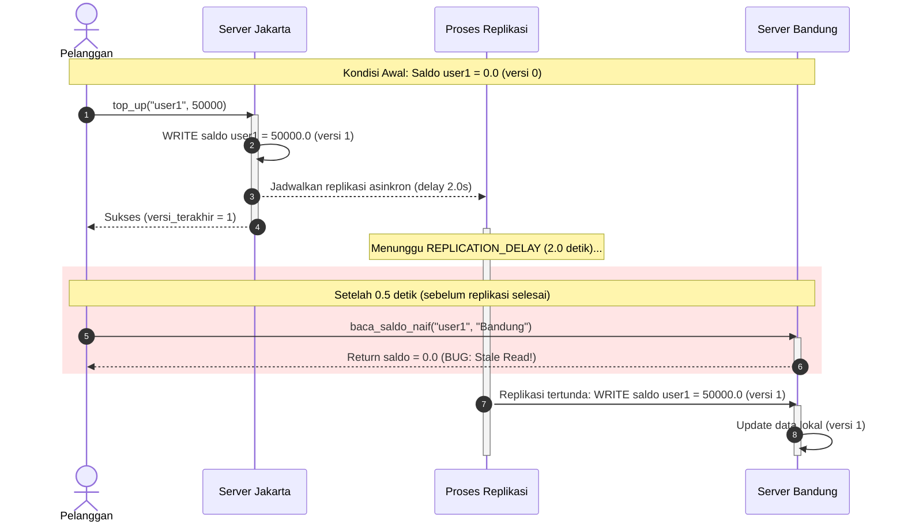
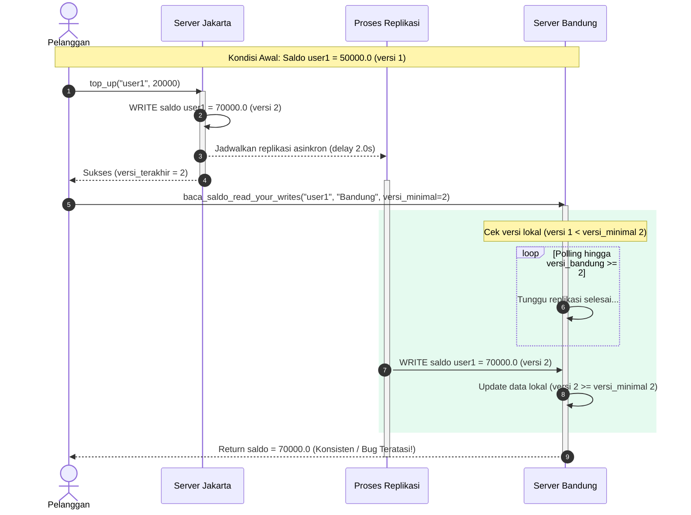

# Tugas 7 (Pekan 7) — Konsistensi Data

**Materi terkait:** Data-Centric Consistency (Sequential, Eventual), Client-Centric Consistency.

## Studi Kasus

Data saldo *e-wallet* pelanggan FoodGo berbeda antara server wilayah **Jakarta** dan **Bandung** karena replikasi antar server berjalan lambat. Contoh kasus nyata: pelanggan top-up saldo lewat server Jakarta, lalu dalam hitungan detik memesan makanan lewat aplikasi yang tersambung ke server Bandung — saldo belum ter-update, transaksi ditolak padahal saldo sebenarnya cukup.

## Tugas Kelompok

### Bagian 1 — Analisis (wajib)

1. Tentukan: apakah kasus ini **membutuhkan Sequential Consistency** (semua replika melihat urutan operasi yang sama) atau **cukup Eventual Consistency** (replika akan konsisten "pada akhirnya", boleh sementara berbeda)? Berikan argumen berbasis dampak bisnis (mis. kasus saldo *e-wallet* jauh lebih sensitif dibanding kasus "jumlah like" di media sosial).
Untuk kasus saldo *e-wallet* **tidak cukup** jika hanya bergantung pada *Eventual Consistency* biasa.
- **Argumen Dampak Bisnis:** Saldo uang digital bersifat sangat sensitif langsung berdampak finansial dan kenyamanan user. kalau pakai *Eventual Consistency* biasa tanpa pengamanan tambahan, pas server *delay* sinkron, saldo user bisa-bisa kebaca 0 atau belum nambah padahal dia baru aja *top-up*. Akibatnya? Transaksi pesan makanannya bisa ditolak sama sistem. Pastinya bikin user kesal dan kapok pakai aplikasinya.
- **Solusi yang Dipilih:** Makanya, sistem ini butuh pendekatan **Client-Centric Consistency**, khususnya konsep **Read-Your-Writes**. Jadi, begitu user selesai melakukan *write* (alias *top-up* saldo), sistem bakal mastiin kalau user itu sendiri *bakal langsung* melihat saldo terbarunya dengan akurat di aplikasinya, gak peduli server wilayah lain udah kelar sinkron atau belum.

2. Jika kalian menyimpulkan Eventual Consistency saja **tidak cukup** untuk skenario ini, usulkan pendekatan **Client-Centric Consistency** yang relevan (mis. *Read-Your-Writes*: pelanggan yang baru top-up harus selalu melihat saldo terbarunya sendiri, walau replika lain belum sinkron).
- **Kasus:** Fitur "Riwayat Pendapatan & Saldo Driver" di aplikasi ojek online *RideFast*. Pas seorang driver baru aja nyelesaiin orderan, duit pendapatannya dicatat dulu ke server pusat (Jakarta), terus data posisinya bakal di-update ke server regional terdekat.
- **Model Konsistensi yang Tepat:** Kita butuh gabungan **Sequential Consistency** buat ngeberesin urutan transaksi finansial *driver* biar datanya gak "macet" atau dobel, ditambah **Read-Your-Writes** khusus di aplikasi *driver*-nya supaya pendapatan yang baru masuk bisa langsung kelihatan pas si *driver* ngecek saldo dompetnya sendiri secara real-time.

3. Gambarkan **diagram alir urutan (sequence diagram)** yang menunjukkan operasi read/write antara pelanggan, server Jakarta, server Bandung, dan proses replikasi — untuk skenario **tanpa** jaminan konsistensi (bug terjadi) DAN skenario **dengan** solusi yang kalian usulkan (bug teratasi). Pakai Mermaid (`sequenceDiagram`) di `README.md` — lihat contoh cara pakai di Tugas 2.



---

### 2. Skenario Dengan Solusi (`baca_saldo_read_your_writes` — Bug Teratasi)
Pelanggan menyertakan parameter `versi_minimal` (`versi_terakhir`) saat meminta data ke Server Bandung. Jika versi data pada Server Bandung masih lebih kecil dari `versi_minimal`, fungsi `baca_saldo_read_your_writes` akan melakukan *polling* (menunggu) hingga proses replikasi selesai memperbarui data di Server Bandung, barulah saldo yang akurat dikembalikan.

````markdown

````

### Bagian 2 — Simulasi (opsional, nilai tambah)

Skeleton `src/replica_simulation.py` mensimulasikan dua replika (Jakarta & Bandung) dengan delay replikasi buatan. Lengkapi TODO untuk:
1. Menunjukkan kondisi **inconsistent read** (replika Bandung masih menunjukkan saldo lama walau Jakarta sudah update).
2. Mengimplementasikan mekanisme **Read-Your-Writes** sederhana (mis. dengan version/timestamp per client) yang memperbaiki masalah tersebut.

```bash
python3 src/replica_simulation.py
```

## Struktur Submission

```
tugas-07-konsistensi-data/
├── README.md      # Analisis konsistensi + sequence diagram Mermaid
├── JURNAL.md
├── src/            # (opsional) simulasi replikasi
└── bukti/          # (jika mengerjakan simulasi) output program
```

## Rubrik Penilaian (Tugas 7)

| Komponen | Bobot | Kriteria |
|---|---|---|
| Ketepatan pemilihan model konsistensi | 30% | Argumen berbasis dampak bisnis nyata, bukan hafalan definisi |
| Kualitas sequence diagram | 30% | Menunjukkan jelas titik kegagalan & titik perbaikan |
| Usulan solusi client-centric | 25% | Solusi konkret dan dapat diimplementasikan (bukan wacana abstrak) |
| Proses & kontribusi kelompok | 15% | `JURNAL.md`, commit history (+ bonus jika simulasi dikerjakan) |

## Batasan Penggunaan AI (Level 2)

Kebijakan **Level 2 (AI Assisted Idea Generation & Structuring)** berlaku — lihat [`../RUBRIK-UMUM.md`](../RUBRIK-UMUM.md). Boleh bertanya konsep umum consistency model ke AI untuk brainstorming; **tidak boleh** meminta AI menuliskan analisis akhir/sequence diagram atau isi `# TODO` di `src/replica_simulation.py` yang tinggal ditempel. Catat pemakaian AI di "Log Penggunaan AI" pada `JURNAL.md`.

- Sebagai bukti pemahaman konsep (bukan hafalan jawaban skenario FoodGo saja), `README.md` wajib menyertakan **satu skenario tambahan** yang kalian buat sendiri (mis. kasus lain di aplikasi ojek online) dan menentukan model konsistensi yang tepat untuk skenario tambahan tersebut.
